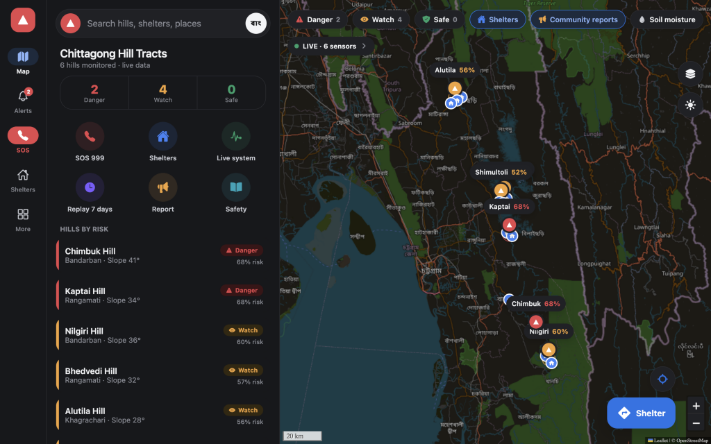
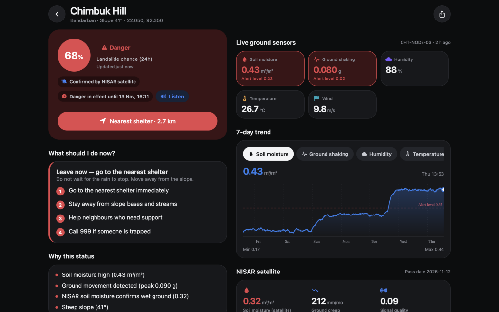
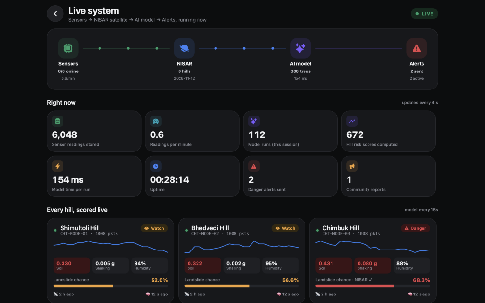
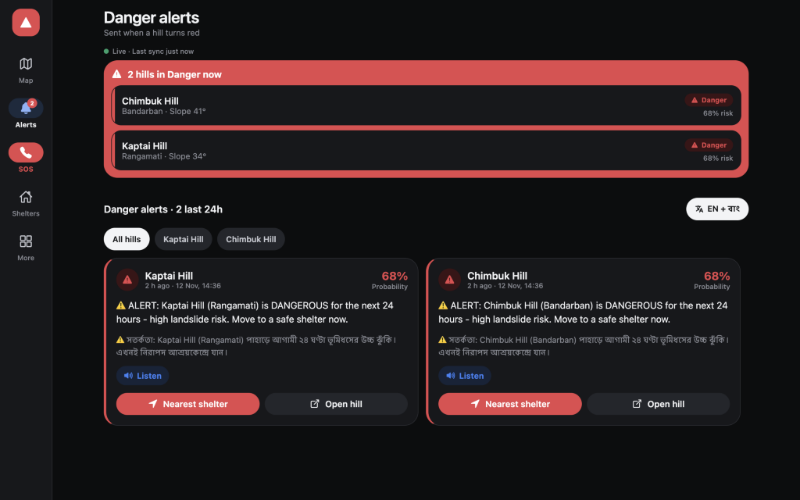

# Pahar Pohori (পাহাড় প্রহরী)

**Hill Tracts Landslide Early Warning System** — combining ground IoT sensor telemetry, NASA-ISRO **NISAR** radar displacement & soil moisture features, a trained Random Forest risk model, and a bilingual (**English / বাংলা**) mobile and web application for communities across the Chittagong Hill Tracts.

---

## Screenshots

| Interactive Risk & Shelter Map | Hill Detail & 7-Day Telemetry |
| :---: | :---: |
|  |  |

| Live Watch (Pipeline & Nodes) | Bilingual Danger Alerts (EN / বাংলা) |
| :---: | :---: |
|  |  |

---

## How It Works

```text
Field Sensor Nodes (CHT-NODE-01..06) ──▶ 7-Day Archive / POST /api/ingest
                                                   │
NISAR Features (GUNW creep + SME2 moisture) ───────┼──▶ Random Forest Model (12 features, 30-reading window)
                                                   │
                                      Cross-verification & 24h DANGER hold
                                                   │
                                      SAFE / WATCH / DANGER ──▶ Bilingual Alerts & Shelters UI
```

- **Cross-verification rule:** A hill enters **DANGER** only when the model probability meets the danger threshold (`>= 0.60`) **and** ground soil moisture is wet (`>= 0.32 m³/m³`) **and** NISAR satellite features confirm either wet soil or slope creep. Otherwise, elevated probabilities stay at **WATCH** to avoid false panic alarms.
- **24-hour hold:** Once a hill triggers **DANGER**, the status is held for 24 hours with bilingual (Bangla + English) emergency instructions and nearest shelter routing.

---

## Project Structure

```text
pahar_prohori/
├── docs/screenshots/
├── backend/                 # FastAPI + SQLite + ML + sensor archive
│   ├── app/                 # main, db, predictor, refresh, status, live, public, …
│   ├── ml/                  # features, make_train, train, model
│   ├── sensors/             # build_archive, load_archive
│   ├── scripts/export_snapshot.py
│   ├── data/
│   ├── docs/api.html
│   └── requirements.txt
└── pahar-pohori-app/        # Expo RN + web
```

---

## Key Features

- **Interactive Risk Map:** Color-coded risk pins and probability circles (`SAFE`, `WATCH`, `DANGER`), 12 community shelters, community hazard report pins, 7-day risk replay timeline, and switchable Standard / Satellite / Terrain OpenStreetMap-based layers.
- **Hill Detail & Telemetry:** Live ground sensor tiles (soil moisture, ground shaking, humidity, temperature, wind), interactive 7-day charts, Open-Meteo rain forecast, NISAR satellite metrics, and step-by-step action guidance with text-to-speech (`expo-speech`).
- **Live Watch:** Real-time pipeline telemetry showing sensor packet counts, NISAR pass status, model run latency, per-hill sparklines, and a streaming event log.
- **Bilingual Alerts & Offline Support:** Simultaneous Bangla & English alert feed, offline device cache with built-in fallback snapshot, and automatic background submission for queued citizen hazard reports.
- **SOS & Shelter Routing:** Press-and-hold `999` emergency dialer, national disaster hotlines (`999`, `1090`, `333`), distance-sorted shelters, and turn-by-turn walking/driving shelter routes.

---

## Quick Start

### 1. Backend (`backend`)

```bash
cd backend
python3 -m venv .venv
source .venv/bin/activate        # Windows: .venv\Scripts\activate
pip install -r requirements.txt
uvicorn app.main:app --host 0.0.0.0 --port 8000
```

- **API & Swagger Docs:** `http://localhost:8000/docs`
- **Frontend API Guide:** `http://localhost:8000/guide`

### 2. Frontend (`pahar-pohori-app`)

**Option A — Production Web Build (served directly by FastAPI on port `8000`):**

```bash
cd pahar-pohori-app
npm install
npm run build:web
```

Once built, `http://localhost:8000` serves both the website and all `/api/*` endpoints from the same origin.

**Option B — Development Mode (Expo Go on mobile + Web dev server):**

```bash
cd pahar-pohori-app
npm install
npx expo start
```

Press `w` for web (`http://localhost:8081`) or scan the QR code with **Expo Go** on the same Wi-Fi network.

---

## API Endpoints

| Method | Endpoint | Purpose |
| :--- | :--- | :--- |
| `GET` | `/api/health` | Service health check |
| `GET` | `/api/summary` | Status counts and 24-hour alert count |
| `GET` | `/api/hills` | All monitored hills, latest reading, NISAR & risk status |
| `GET` | `/api/hills/{id}` | Detailed profile, NISAR metrics, and risk reasons for one hill |
| `GET` | `/api/hills/{id}/history` | Historical sensor readings for 7-day charts |
| `GET` | `/api/hills/{id}/shelters` | Nearest shelters sorted by distance |
| `GET` | `/api/risk-timeline` | Hourly 7-day ML risk replay across all hills |
| `GET` | `/api/system-status` | Live pipeline status, node trends, and model timing |
| `GET` | `/api/live-feed` | Incremental live pipeline event log |
| `POST` | `/api/ingest` | Ingest a live sensor packet and recompute risk |
| `GET` | `/api/alerts` | Bilingual `DANGER` alert history |
| `GET` | `/api/shelters` | All shelters (optional `lat`, `lon`, `district` filters) |
| `GET` | `/api/emergency-contacts` | Emergency hotline numbers (`999`, `1090`, `333`) |
| `GET` / `POST` | `/api/reports` | Fetch or submit community hazard reports |
| `GET` | `/api/model-info` | Model ROC-AUC and feature importance |
| `POST` | `/api/refresh` | Recompute risk status for all hills |

---

## Tech Stack

- **Backend:** Python, FastAPI, Uvicorn, SQLite, pandas, NumPy, scikit-learn, joblib
- **Frontend:** TypeScript, React Native, Expo SDK 58, React Navigation, Leaflet, OpenStreetMap, OSRM, Open-Meteo

## Contributors

- **Al Sami** ([@al-sami-2005](https://github.com/al-sami-2005))
- **Masud Rana** ([@masudranaxpert](https://github.com/masudranaxpert))
